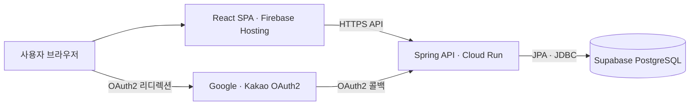

# 시스템 개요

웹 SPA가 인증된 API 요청으로 Java/Spring 백엔드를 호출한다. 백엔드는 PostgreSQL에서 계정, 프로그램과 운동 기록을 관리한다. 브라우저는 Google·Kakao 로그인 시 백엔드의 OAuth2 흐름을 거쳐 웹 콜백으로 돌아온다.

| 저장소 | 기본 브랜치와 검증 기준 | 주요 구조 |
| --- | --- | --- |
| [fitlog-v2-docs](https://github.com/pby1360/fitlog-v2-docs) | `main` · [현황 검증 기준 커밋](../status/CURRENT_STATUS.md) | [README](../README.md)에서 공식 문서 탐색 |
| [fitlog-v2-server](https://github.com/pby1360/fitlog-v2-server/tree/1154a06268b0336ab5154c9c2c0d8b405bad8717) | `main` · `1154a06` | `src/main`, `src/test`, Gradle, Docker, GitHub Actions |
| [fitlog-v2-web](https://github.com/pby1360/fitlog-v2-web/tree/3d6412ec605ed6f83f86b1e51d6b740df9db25d2) | `main` · `3d6412e` | `src/`, `public/`, Vite, Firebase Hosting, GitHub Actions |

[프런트엔드](FRONTEND.md), [백엔드](BACKEND.md), [데이터 모델](DATA_MODEL.md), [API 목록](../api/README.md)에서 각 경계의 계약을 관리한다. 그림의 호스팅 서비스는 [배포](../operations/DEPLOYMENT.md)에 남긴 저장소 구성과 이관 기록을 따른다. 운영 실측 근거가 필요한 항목은 [현재 상태](../status/CURRENT_STATUS.md)에 있다. AI는 [후속 설계](../features/ai-coaching/TECH_SPEC.md)에 있다.

| 추적 정보 | 내용 |
| --- | --- |
| 문서 상태 | 검토 중 |
| 원본 출처 | Obsidian `TECH_SPEC.md`, `fitlog-v2-MoC.md`, `배포.md`, `TASKS.md` 및 두 저장소의 main |
| 관련 기능 또는 Issue | [전체 기능](../features/README.md) |
| 최종 검증일 | 2026-11-18 |
| 관련 설계 | [프런트엔드](FRONTEND.md), [백엔드](BACKEND.md), [데이터 모델](DATA_MODEL.md) |
